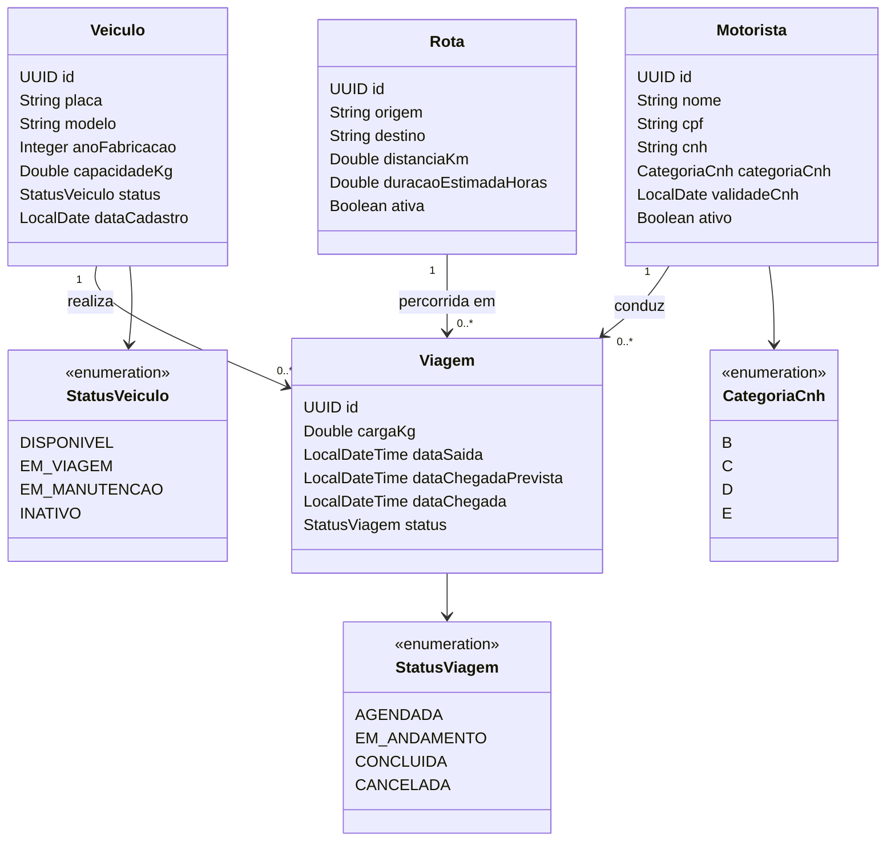

# API de Controle de Frotas

> API REST para uma empresa de logística gerenciar sua frota: veículos, motoristas e as viagens realizadas.

Projeto final da disciplina de Backend, Engenharia de Software.

## Tema

**Logística e Transporte**

## Integrantes

| Nome                       | Papel                                       |
|----------------------------|---------------------------------------------|
| Gustavo D'Agostin Zanelato | Desenvolvedor (projeto individual) |

## Problema e domínio

Uma empresa de logística precisa saber quais veículos possui, quais motoristas estão habilitados e quais viagens estão agendadas, em andamento ou concluídas. Sem esse controle, é comum alocar um veículo ou motorista em duas viagens ao mesmo tempo, ou designar um motorista sem a habilitação adequada.

A API centraliza esses dados e expõe operações REST para cadastrar, consultar, atualizar e remover cada recurso.

## Tecnologias

- Java 17
- Spring Boot 4.1.1
  - Spring Web MVC (API REST)
  - Spring Data JPA (persistência)
  - Bean Validation (validação de entrada)
- H2 Database (banco em arquivo, com console web)
- Maven (via Maven Wrapper, não precisa instalar)

## Entidades

| Entidade | Descrição | Campos principais |
|---|---|---|
| `Veiculo` | Veículo da frota | placa (única), modelo, ano de fabricação, capacidade (kg), status, data de cadastro |
| `Motorista` | Motorista da empresa | nome, CPF (único), CNH (única), categoria da CNH, validade da CNH, ativo |
| `Rota` | Trajeto cadastrado entre dois pontos, reutilizável por várias viagens | origem, destino, distância (km), duração estimada (h), ativa |
| `Viagem` | Execução de uma rota por um motorista com um veículo | carga (kg), data de saída, data de chegada prevista, data de chegada, status, rota, veículo, motorista |

Relacionamentos:

- `Veiculo` 1:N `Viagem`: um veículo realiza várias viagens.
- `Motorista` 1:N `Viagem`: um motorista realiza várias viagens.
- `Rota` 1:N `Viagem`: uma rota pode ser percorrida em várias viagens.

A combinação origem + destino identifica uma rota (não pode haver duas iguais).

Observação sobre as datas da `Viagem`: `dataChegadaPrevista` é informada no agendamento, antes da jornada começar. `dataChegada` é a chegada real e só é preenchida quando a viagem é concluída (fica vazia até lá).

Enums:

- `StatusVeiculo`: `DISPONIVEL`, `EM_VIAGEM`, `EM_MANUTENCAO`, `INATIVO`
- `StatusViagem`: `AGENDADA`, `EM_ANDAMENTO`, `CONCLUIDA`, `CANCELADA`
- `CategoriaCnh`: `B`, `C`, `D`, `E`

### Diagrama UML



### Regras de negócio da API base

| Situação | Código HTTP |
|---|---|
| Placa, CPF ou CNH já cadastrados | 409 |
| Rota com a mesma origem e destino já cadastrada | 409 |
| Excluir rota, veículo ou motorista que já possui viagens | 409 |
| Rota inativa usada em uma viagem | 422 |
| Carga acima da capacidade do veículo | 422 |
| Motorista inativo ou com CNH vencida | 422 |
| Veículo em manutenção ou inativo | 422 |
| Chegada prevista anterior à data de saída | 422 |
| Rota, veículo, motorista ou viagem inexistente | 404 |
| Campo obrigatório vazio ou formato inválido | 400 |

## Como executar

### Pré-requisitos

- JDK 17 ou superior
- Git

### Passo a passo

```bash
# 1. Clonar o repositório
git clone <URL-DO-REPOSITORIO>
cd ProjetoFinalBackend

# 2. Subir a aplicação (Windows)
.\mvnw.cmd spring-boot:run

# 2. Subir a aplicação (Linux/macOS)
./mvnw spring-boot:run
```

A API ficará disponível em `http://localhost:8080`.

### Banco de dados

O projeto usa o **H2 em modo arquivo**, criado automaticamente na primeira execução (arquivo na raiz do projeto). Não é necessário instalar nenhum banco.

Console web do H2: `http://localhost:8080/h2-console`

| Campo | Valor |
|---|---|
| JDBC URL | `jdbc:h2:file:./logistica` |
| User | `sa` |
| Password | _(vazio)_ |

### Variáveis de ambiente

Nenhuma é obrigatória por enquanto. A configuração fica em `src/main/resources/application.properties`.

### Executar os testes

```bash
.\mvnw.cmd test
```

## Documentação (a completar nas próximas entregas)

- [ ] Descrição dos DTOs de entrada e saída
- [ ] Validação de dados e exemplos de erros HTTP
- [ ] Paginação, filtros e ordenação, com exemplos de requisição e resposta
- [ ] Carta-desafio: história de usuário, critérios de aceite, implementação e endpoints
